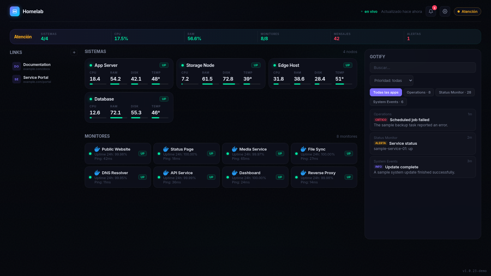

# Homelab Nexus

> A self-hosted dashboard that brings your homelab services and monitoring into one place.

Homelab Nexus combines **Beszel**, **Uptime Kuma**, and **Gotify** in a lightweight dashboard. It is built for Docker and can run with only the integrations you configure; no personal configuration or service data is included in the image.



> **Status:** personal project, shared as-is. Contributions and feedback are welcome.

## Features

- Host metrics from Beszel and status/latency from Uptime Kuma.
- Gotify messages and infrastructure alerts.
- Live updates over Server-Sent Events (SSE).
- Persistent bookmarks, monitor links, alert states, and optional background settings.
- Docker image runs as a non-root user and includes a health check.

## Quick start with Docker Compose

1. Download `docker-compose.yml` and `.env.example` from this repository, then create your local environment file:

   ```bash
   cp .env.example .env
   ```

2. Edit `.env` and set the URLs and credentials for the services you want to display. Each integration is optional; a service is enabled when its URL is configured.

3. Start the dashboard:

   ```bash
   docker compose up -d
   ```

4. Open <http://localhost:3000>.

Compose stores persistent dashboard data in `./data`. Back up this directory before changing or removing it. The container runs as UID 1000; make sure the host directory is writable by that UID.

### Try the image directly

The published image will be available at:

```text
ghcr.io/mateorzan/homelab-nexus-public:latest
```

The image can also be built locally from the repository:

```bash
docker build -t homelab-nexus:local .
```

### Docker Secrets

For a shared server, prefer Docker Secrets over putting credentials in `.env`. Create the files described in [`secrets.example/README.md`](secrets.example/README.md), then start the secrets-based Compose configuration:

```bash
docker compose -f docker-compose.secrets.yml up -d
```

Never commit `.env`, secret files, or your `data/` directory.

## Configuration

| Variable | Required | Description |
|---|---:|---|
| `PORT` | No | HTTP port (default `3000`). |
| `HOST` | No | Bind address (default `0.0.0.0`). |
| `POLL_INTERVAL_MS` | No | Poll interval in milliseconds (default `5000`). |
| `ALLOWED_ORIGINS` | No | Comma-separated additional CORS origins, useful behind a reverse proxy. |
| `DATA_DIR` | No | Persistent data directory (default `data/`). |
| `BESZEL_URL` | No | Beszel hub URL; enables the Beszel integration. |
| `BESZEL_USER_EMAIL` / `BESZEL_USER_PASSWORD` | For Beszel | Read-only Beszel account credentials. |
| `UPTIMEKUMA_URL` | No | Uptime Kuma URL; enables the integration. |
| `UPTIMEKUMA_STATUS_PAGE` | No | Optional public status-page slug. |
| `GOTIFY_URL` | No | Gotify URL; enables the integration. |
| `GOTIFY_TOKEN` | For Gotify | Gotify application/client token. |
| `OPNSENSE_URL` | No | Optional OPNsense URL (integration is currently a stub). |
| `OPNSENSE_API_KEY` / `OPNSENSE_API_SECRET` | For OPNsense | Optional API credentials. |

> URLs must be reachable **from inside the container**. Use a Docker network, a reachable host name, or the host's LAN address as appropriate for your setup.

## Development

Requirements: Node.js 24 or later and npm.

```bash
npm ci
cp .env.example .env
npm run dev
```

Checks:

```bash
npm run typecheck
npm run lint
npm test
npm run test:e2e
```

Build and run the Docker image locally:

```bash
npm run build
docker build -t homelab-nexus:local .
```

## API

| Method | Endpoint | Purpose |
|---|---|---|
| `GET` | `/api/summary` | Dashboard summary and alerts. |
| `GET` | `/api/stream` | Live updates (SSE). |
| `GET` | `/api/health` | Container health check and version. |
| `GET` | `/api/services/:id` | Service details. |

## Releases and container image

GitHub Actions runs type-checking, lint, unit/DOM tests, and browser tests. Version tags build multi-architecture images (`linux/amd64` and `linux/arm64`) and publish them to GitHub Container Registry. After the first successful publish, the maintainer must set the GHCR package visibility to **Public** in the package settings so anyone can pull it without signing in. See the **Packages** section of the repository for the final image name and pull commands.

## Privacy and security

- The project does not ship with your service URLs, credentials, background image, bookmarks, or dashboard data.
- Keep `.env`, Docker secret files, and `data/` private.
- Use a read-only Beszel account where possible, and expose the dashboard only to trusted networks or behind your authenticated reverse proxy.
- Report security issues privately to the repository owner rather than opening a public issue containing sensitive details.

## License

MIT. See [`LICENSE`](LICENSE).

### Third-party assets

- The bundled Inter font is licensed under the SIL Open Font License 1.1; see [`public/fonts/OFL.txt`](public/fonts/OFL.txt).
- Service logos are loaded on demand from [dashboard-icons](https://github.com/walkxcode/dashboard-icons) (Apache-2.0); product names and trademarks belong to their respective owners.
